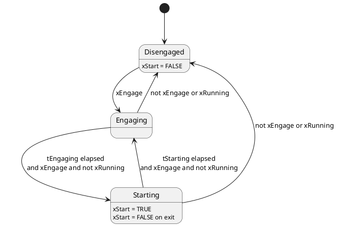
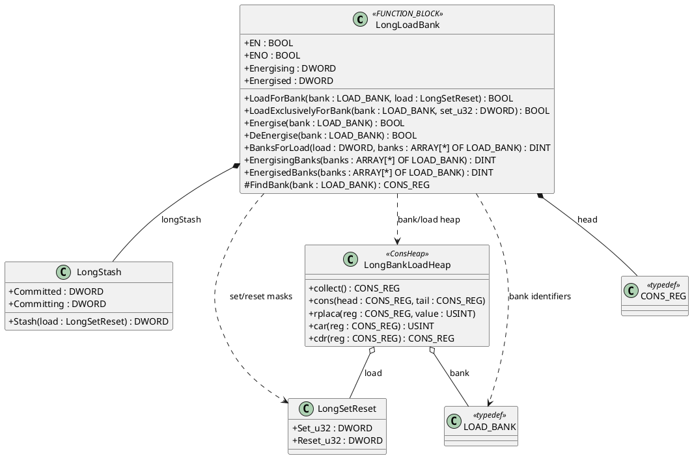

# Canny IEC61131

CODESYS project workspace.

## Function Blocks and Functions

Structured Text templates and library sources live under `st/`.

### Function Blocks (FBs)

Function blocks encapsulate behaviour and may retain state between calls.
Use `st/fb.st` as the template for a function block. Methods belonging to a
function block can follow `st/fbm.st`. The library's function-block sources
are in `st/cannyiec/function_blocks/`.

Available blocks include:

- **Input conditioning and state:** `AsymmetricDebounce` uses separate rise
  and fall delays; `SymmetricDebounce` uses one delay for both. `Button`
  adds debounced state and press/release pulses. `WAS` reports a Boolean
  change and its elapsed time; `DIF` detects a change from the previous scan.
  `FirstCycle` flags the first program cycle, and `FLIP_FLOP` toggles on a
  rising edge.
- **Control and timing:** `AutoStarter` retries timed start commands until
  running feedback arrives or the request is removed.
  `BangBangControllerWithValueHysteresis` switches between separate value
  thresholds; `BangBangControllerWithTimeHysteresis` applies minimum times
  between switches. `PT1` is a first-order filter. `CTUR_TRIG` and
  `CTDR_TRIG` count up or down and emit a one-cycle pulse at the preset.
- **Data handling:** `BINGED` and `FB_BINGED` delay accepting a changed byte by
  the configured latency. `ByteStash`, `WordStash`, and
  `LongStash` stage values and report committed changes. `ConsHeap` manages a
  fixed-size heap of cons cells and a free list. `LongLoadBank` manages a bank
  of loads and reports energising and energised bank sets. Its methods include
  `LoadForBank` and `LoadExclusivelyForBank` to register loads,
  `Energise` and `DeEnergise` to commit or remove a bank's load,
  `BanksForLoad` to find matching banks, and `EnergisingBanks` and
  `EnergisedBanks` to collect banks in each state.

#### AutoStarter

`AutoStarter` generates a timed start command while an engagement request is
active. Its `tEngaging` and `tStarting` inputs default to `T#3S`. After
`xEngage` becomes `TRUE`, the block waits for `tEngaging`, asserts `xStart` for
`tStarting`, then waits another `tEngaging` before trying again. The cycle
stops when `xRunning` becomes `TRUE` or `xEngage` becomes `FALSE`; `xStart` is
deasserted when the start phase ends.

The sequence is:



Call the function block cyclically and use its output to drive the equipment's
start command:

```iecst
fbAutoStarter(
    tEngaging := T#3S,
    tStarting := T#3S,
    xRunning := xMotorRunning,
    xEngage := xAutoStart
);
xMotorStart := fbAutoStarter.xStart;
```

The block has no failure or timeout output. If running feedback never arrives,
it continues retrying while `xEngage` remains `TRUE`. Timing is limited by the
PLC task cycle.

#### LongLoadBank



`LongLoadBank` associates each `LOAD_BANK` identifier with a `LongSetReset`
value. The set and reset masks describe how that bank changes the 32-bit load
state. Registered banks and their load masks are held in `ConsHeap` entries;
`head` identifies the start of the linked list.

Use `LoadForBank` to register a bank and its set/reset masks. It returns
`TRUE` if a free cons cell is available. `LoadExclusivelyForBank` is a
convenience method: it sets both masks to the supplied bit mask, so the bank
requires only those bits and excludes conflicting states.

`Energise` finds a registered bank and passes its load mask to `LongStash`.
`DeEnergise` replaces the masks with their inverse before stashing the
result. `Energising` exposes the pending value from `LongStash.Committing`,
whereas `Energised` exposes the last committed value from
`LongStash.Committed`.

The function block processes pending changes when `EN` is `TRUE`. `ENO` is
set when the commit reports at least one changed bit. Call
`EnergisingBanks` or `EnergisedBanks` to collect matching bank identifiers
into a caller-provided array. `BanksForLoad` scans every registered entry and
counts banks whose set masks are present and whose reset masks are absent in
the supplied load value.

### Functions (FUNs)

Functions return a value and are suited to calculations that do not need
function-block instance state. Use `st/fun.st` as the function template. The
library's function sources are in `st/cannyiec/functions/`.

Available functions include:

- **Byte conversion:** `AU8_TO_U16` combines selected bytes into a `UINT`;
  `U16_TO_AU8` splits a `UINT` into selected byte-array positions.
- **Correlation:** `CrossCorrelate` computes cross-correlation;
  `CrossCorrelateUnitEnergy` returns the unit-energy-normalised result.
- **Predicates:** `ISIGNBIT` and `RSIGNBIT` test whether an integer or real is
  negative. `REPSILONEQ` compares real values within an epsilon.
  `IsTrivalentHolding` and `IsTrivalentKnown` test trivalent states.
- **Time:** `SysTimeRtcHighResGet` reads the high-resolution RTC and reports
  its status; `SysTimeRtcHighResSet` sets the current high-resolution RTC
  time.

## Git Hooks

This repo ships a tracked pre-commit hook (`scripts/pre-commit`) that
pretty-prints staged `.object` files, which CODESYS stores as minified JSON.
Git does not run tracked hooks automatically, so enable it once per clone:

```sh
git config core.hooksPath scripts
```

The hook requires a `python3`/`python`/`py` interpreter on `PATH`; if none is
found it skips prettification without failing the commit.

## Project Version

`python scripts/update_version.py` updates the Project Information version as
`Major.Minor.Patch.Build`. Use `--dry-run` to preview without writing.

- Major, minor and patch come from the nearest release tag on HEAD's
  first-parent history, named `v0.1.2` or `0.1.2`.
- Build is the number of first-parent commits since that tag: the tag itself
  produces `0.1.2.0`, and five subsequent commits produce `0.1.2.5`.
- Other tag formats and tags on merged side branches are ignored. To begin a
  new patch cycle, explicitly create a new release tag.
- Full history and tags are required in build checkouts; shallow history or a
  missing baseline causes an error. Branch names do not affect the version.
- Uncommitted changes do not affect the number. Use a clean checkout for
  releases and record the Git SHA alongside build artifacts for traceability.

The script does not create tags. For an initial `0.1.0` baseline at the current
commit, run `git tag v0.1.0` explicitly.

Run the versioning tests with `python -m unittest discover -s scripts -p "test_*.py"`.

## GitHub Releases

Preview a release using the version already stored in Project Information:

```sh
python scripts/create_release.py --dry-run
```

Publish it with:

```sh
python scripts/create_release.py
```

The script requires Git and an authenticated GitHub CLI (`gh auth login`).
It creates `vMajor.Minor.Patch.Build` (for example, `v0.2.0.42`) in the `origin`
repository with generated release notes, targeting the checked-out HEAD commit.
Commit and push your changes before publishing: the checkout must be clean,
including untracked files, and the Project Information object must be tracked.
An existing remote tag must point to HEAD; an existing release is left unchanged
and reported as a `gh` error. Dry-run only previews the command without contacting
GitHub or requiring a clean checkout.

The script does not update the stored version, commit files, or push commits.
